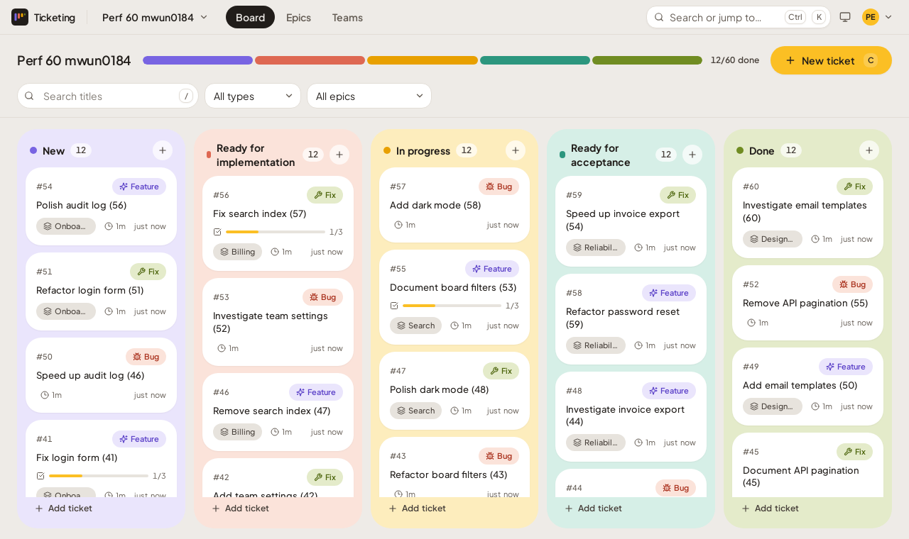
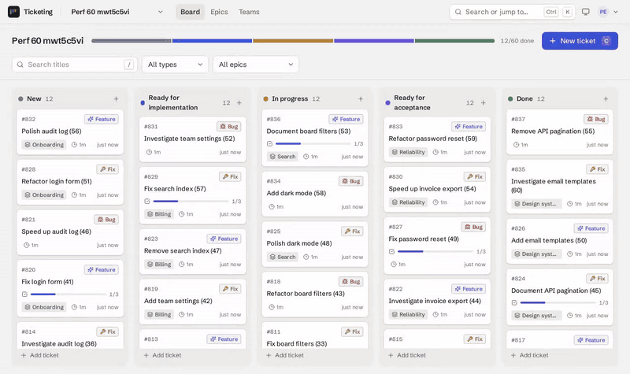
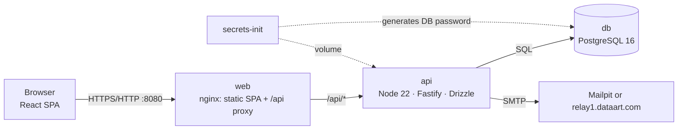

# Ticketing

A Kanban ticket tracker for small teams. You sign up with email and password, verify through a real SMTP message, and move tickets across a fixed five-state board: New → Ready for implementation → In progress → Ready for acceptance → Done. Each team has its own board, epics group related work, and every ticket has a Markdown body, comments and an activity history. A drag is saved to the database the moment you drop the card. If the server refuses the move, the card returns to its column and you see the error.





## Prerequisites

- Docker Desktop (Windows, macOS) or Docker Engine with the Compose v2 plugin (Linux).
- Nothing else. Node, PostgreSQL and the browser test runner all run in containers.

## Quick start

```sh
docker compose up --build
```

| What | Where |
| --- | --- |
| App | http://localhost:8080 |
| Emails sent by the app (Mailpit) | http://localhost:8025 |
| API reference (OpenAPI / Swagger UI, after logging in) | http://localhost:8080/api/docs |
| Health / readiness | http://localhost:8080/api/health, http://localhost:8080/api/ready |

First run:

1. Open the app and choose **Create an account**.
2. Open Mailpit and click the verification link.
3. Log in. The onboarding card walks you through creating a team, an epic and your first ticket.

The database starts empty: migrations run automatically when the API starts, and no seed data is loaded.

## Configuration

Every setting has a working default, so a `.env` file is optional. To change a setting, copy `.env.example` to `.env` and edit it; never commit `.env`.

| Variable | Default | Purpose |
| --- | --- | --- |
| `WEB_PORT` | `8080` | Host port of the web app (nginx serves the SPA and proxies `/api`). |
| `MAILPIT_PORT` | `8025` | Host port of the Mailpit inbox UI. |
| `APP_BASE_URL` | `http://localhost:8080` | Public URL of the app, used to build links in emails. |
| `SMTP_HOST` | `mailpit` | SMTP server. |
| `SMTP_PORT` | `1025` | SMTP port. |
| `SMTP_SECURE` | `false` | `true` for implicit TLS (port 465). STARTTLS is negotiated automatically when offered. |
| `SMTP_USER` / `SMTP_PASS` | empty | SMTP credentials. Leave empty for relays that need no authentication. |
| `MAIL_FROM` | `Ticketing <no-reply@ticketing.local>` | Sender address. |
| `COOKIE_SECURE` | `false` | Set to `true` when the app is served over HTTPS. |
| `SHOW_MAILPIT_LINK` | `true` | Build-time flag: shows an "Open Mailpit" shortcut on the check-your-email screen. Set to `false` with a real SMTP server. |

The database password is not configurable and is never in the repository. On first start, the `secrets-init` container generates a random 32-character password into a Docker volume, and both Postgres and the API read it from there (`POSTGRES_PASSWORD_FILE`, `DB_PASSWORD_FILE`). The database port is not published to the host.

### Using relay1.dataart.com

Put this in `.env` and restart with `docker compose up --build`:

```dotenv
SMTP_HOST=relay1.dataart.com
SMTP_PORT=25
SMTP_SECURE=false
SMTP_USER=
SMTP_PASS=
MAIL_FROM=Ticketing <no-reply@your-domain.example>
APP_BASE_URL=http://<host-name-or-ip-of-this-machine>:8080
SHOW_MAILPIT_LINK=false
```

`APP_BASE_URL` must be an address that the recipient's browser can reach, because the verification link in the email points there. The relay accepts mail only from inside the DataArt network.

## Architecture



- **Presentation:** `apps/web` is a React 18 + Vite SPA, built into static files and served by nginx.
- **Application:** `apps/api` is a Fastify 5 HTTP API that validates every request against shared zod schemas. It publishes an OpenAPI document generated from those same schemas.
- **Persistence:** `apps/api/drizzle` holds plain SQL migrations. They define foreign keys, check constraints, case-insensitive unique indexes and a trigger that advances `modified_at` only on a real change. The API applies them on startup.
- **Shared contract:** `packages/shared` holds the enums, request schemas, DTO types, quick-add parser and checklist helpers that both tiers use.

## Running tests

```sh
# 1. Typecheck + unit and integration tests (shared, API against a throwaway Postgres, web with jsdom)
docker compose -f docker-compose.test.yml run --rm --build api-test npm run ci
docker compose -f docker-compose.test.yml down -v

# 2. End-to-end tests in a real browser (Playwright + axe accessibility checks) against the full stack
docker compose -f docker-compose.yml -f docker-compose.e2e.yml up -d --build --wait web
docker compose -f docker-compose.yml -f docker-compose.e2e.yml run --rm --build e2e

# 3. Performance check: 300 tickets created through the public API, then measured in Chromium
docker compose -f docker-compose.yml -f docker-compose.e2e.yml run --rm e2e \
  sh -c "SEED_OUT=/tmp/seed.json npx tsx scripts/seed-300.ts && npx tsx scripts/perf-check.ts"
```

Current results:

| Suite | Result |
| --- | --- |
| Shared, API and web unit and integration tests | 30 + 146 + 53 tests pass |
| Playwright end-to-end, including axe checks in both themes | 12 tests pass |
| Board with 300 tickets | First card in 0.4 s; filter responds in under 0.1 s; main-thread tasks stay under 60 ms during a drag; about 70 of the 300 cards are in the DOM at once because long columns are virtualized |

The seed script is a developer tool. It never runs at startup and only creates data through the public API.

GitHub Actions (`.github/workflows/ci.yml`) runs suites 1 and 2 on every push.

## Requirements traceability

Every row points to the code that implements the requirement and to the test that proves it. Test names are quoted exactly. **API** tests are in `apps/api/test/<file>`, **web** unit tests sit next to their component, and **e2e** steps are in `e2e/tests/<file>`.

### 2. Architecture

| Requirement | Implemented in | Proof |
| --- | --- | --- |
| SPA frontend | `apps/web` (React, react-router) | e2e `mvp.spec.ts` runs entirely in the SPA |
| Backend HTTP API | `apps/api/src/app.ts` | API `health.test.ts` "GET /api/health returns 200"; OpenAPI at `/api/docs` |
| RDBMS for all persistent data | `apps/api/src/db/schema.ts`, `apps/api/drizzle/*.sql` | API `db.test.ts` "has every app table and no rows in any of them" |
| Clear separation of tiers | `web` / `api` / `db` services in `docker-compose.yml` | Architecture diagram above |
| Separate containers or API serving the SPA | nginx `web` container proxies `/api` to `api` (`apps/web/nginx.conf`) | e2e runs against `http://web` |
| Dedicated server-based RDBMS container | `db: postgres:16-alpine` | `docker compose ps` |
| Cross-platform | Only Docker images; `.gitattributes` forces LF in scripts | CI on Linux; developed on Windows |
| `docker compose up --build` from a clean checkout, no host runtimes | `docker-compose.yml`, multi-stage Dockerfiles | CI job "e2e" boots from a clean checkout |

### 3. User accounts and authentication

| Requirement | Implemented in | Proof |
| --- | --- | --- |
| Sign up with email and password; email trimmed, case-insensitive, unique | `packages/shared/src/schemas.ts` (`emailSchema`), unique index on `lower(email)` | API `auth.test.ts` "runs the full flow with email normalisation", "rejects a duplicate email in any casing"; `db.test.ts` "treats emails case-insensitively as unique"; e2e `mvp.spec.ts` signs up with `"  EMAIL "` |
| Log in and log out with local credentials | `apps/api/src/auth/routes.ts`, header account menu → Log out | e2e `mvp.spec.ts` steps "log in" and "log out" |
| Password ≥ 8 chars, never plain text, Argon2id | `passwordSchema`, `apps/api/src/auth/passwords.ts` (@node-rs/argon2) | API `auth.test.ts` "rejects a short password with a field error", "stores an argon2id hash and never returns it" |
| Verification email through configurable SMTP; supports relay1.dataart.com | `apps/api/src/mail/mailer.ts` (nodemailer), `SMTP_*` env | e2e `mvp.spec.ts` "verify through the link from Mailpit"; README section "Using relay1.dataart.com" |
| Unverified account cannot use the app | `apps/api/src/auth/service.ts` login check | API `auth.test.ts` "signup → verify → login"; e2e "login is blocked until the email is verified" |
| Token expires after 24 h, single-use; success leads to login | `apps/api/src/auth/tokens.ts`, `VerifyPage.tsx` | API "issues tokens that expire 24 hours after issue", "rejects an expired token"; web `VerifyPage.test.tsx` "explains a used link", "verifies once, even under StrictMode, and links to login" |
| Resend from login or verification-result screen; new token invalidates old | `ResendForm.tsx` on Login (always available), Check-email and Verify pages; `auth/service.ts` | API "resend invalidates the previous token"; web "explains an expired link and offers to resend", `LoginPage.test.tsx` "offers to resend the verification email before any login attempt" |
| Everything requires auth except signup, login, verify, resend (+ static and health) | `apps/api/src/auth/guard.ts` (deny by default), `RequireAuth.tsx` | API `guard.test.ts`: every private route (including `/api/docs`) returns 401 without a session and with a forged cookie, and the public list stays reachable; web `RequireAuth.test.tsx` |

### 4. Teams

| Requirement | Implemented in | Proof |
| --- | --- | --- |
| Tickets grouped by team | `tickets.team_id` FK, board per team | API `tickets.test.ts` "only shows the team's own tickets and 404s for an unknown team" |
| List, create, rename, delete teams | `apps/api/src/teams/*`, `TeamsPage.tsx` | API `teams.test.ts` "creates, lists, renames and deletes a team with ISO UTC timestamps" |
| Id, name, created, modified | `teams` table | same test |
| Name non-empty after trim, unique case-insensitively | `TeamBody`, unique index on `lower(btrim(name))` | API "rejects a whitespace-only name", "rejects duplicate names that differ only by case or surrounding spaces"; web `TeamsPage.test.tsx` "rejects a blank name without calling the API" |
| No delete while it has tickets or epics; clear UI message; no cascade | `teams/service.ts` → 409; FKs `ON DELETE RESTRICT`; disabled delete button with reason | API "refuses to delete a team with epics or tickets and reports counts"; `db.test.ts` "refuses to delete a team that still has an epic"; web "disables deleting a team that still has tickets and says why"; e2e "a team that still has an epic cannot be deleted" |
| All verified users manage all teams | No ownership model | — |

### 5. Epics

| Requirement | Implemented in | Proof |
| --- | --- | --- |
| Belongs to exactly one team; team fixed after creation | `epics.team_id NOT NULL`, `EpicUpdateBody` is strict (no `teamId`) | API `epics.test.ts` "rejects an unknown team, a blank title and a team change" |
| Separate epic CRUD screen | `EpicsPage.tsx` at `/epics` | API "creates, lists, updates and deletes an epic"; e2e step "create an epic"; axe check on the epics page |
| Id, team, title, optional description, created, modified | `epics` table | same API test |
| Title non-empty after trim | `EpicCreateBody` | API "rejects … a blank title" |
| Ticket optionally references one epic from a drop-down | `TicketForm.tsx` Epic select | e2e "create a ticket with the epic" |
| Epic must belong to the ticket's team (backend enforced) | Composite FK `tickets_epic_same_team` + service check | API `tickets.test.ts` "rejects an epic from another team", "refuses to move a ticket to another team while it keeps a foreign epic"; `db.test.ts` "rejects a ticket whose epic belongs to another team" |
| No delete while referenced; clear UI message | `epics/service.ts` → 409; disabled delete button with reason | API "refuses to delete an epic used by tickets" |

### 6. Tickets

| Requirement | Implemented in | Proof |
| --- | --- | --- |
| Fields: id, team, type, state, epic, title, body, created at, modified at, created by | `tickets` table, `TicketDto` | API "creates a ticket with defaults, author and ISO timestamps" |
| Type is exactly bug, feature or fix; state is one of the five canonical values; UI shows readable labels | `packages/shared/src/enums.ts`, DB check constraints | shared "has the exact types and states in workflow order"; `db.test.ts` "rejects an unknown type or state" |
| Title non-empty after trim; body non-empty | `TicketCreateBody` | shared "rejects blank title and body"; web "flags a whitespace-only title without calling the API" |
| Created and modified set by the server in UTC; created by set from the session | DB defaults, trigger, `tickets/service.ts` | API "creates a ticket with defaults, author and ISO timestamps" |
| Create a ticket | `POST /api/tickets`, New ticket button, quick add | e2e "create a ticket with the epic" |
| View all fields including created by, created and modified | `TicketPanel.tsx` metadata block | e2e "open it and add a comment" checks "Created by" |
| Edit type, team, epic, title, body, state | `PATCH /api/tickets/:id`, `TicketForm.tsx` | API "advances modifiedAt and records one event per changed field"; e2e "edit the title; Modified changes" |
| Saving unchanged values does not advance modified | Trigger compares old and new rows | API "keeps modifiedAt and records no events when nothing changes"; `db.test.ts` "advances modified_at only when a business field changes"; web "keeps Save disabled in edit mode until something changes" |
| Team change clears the epic in the UI; backend rejects a foreign epic | `TicketForm.tsx` `changeTeam`, composite FK | web "clears the epic and lists only the new team's epics when the team changes"; API "refuses to move a ticket to another team while it keeps a foreign epic" |
| Delete after explicit confirmation; comments deleted too | `ConfirmDialog`, `ON DELETE CASCADE` for comments | API "deletes the ticket with its comments and events"; e2e "delete the ticket after confirming" |
| Drag-and-drop state change persisted immediately | `useMoveTicket.ts` → `PATCH /api/tickets/:id/state` | API "persists a state change and puts the ticket first on the board"; e2e "drag it to In progress; it stays there after reload" |
| Backend validates enums and references | zod schemas, FKs, check constraints | API "rejects an unknown team or epic", "rejects an invalid state", "validates PATCH fields like create" |

### 7. Comments

| Requirement | Implemented in | Proof |
| --- | --- | --- |
| Add comments to a ticket | `apps/api/src/comments/*`, `Comments.tsx` | e2e "open it and add a comment" |
| Id, ticket, author, body, created | `comments` table | API `comments.test.ts` "lists comments oldest first with author and time" |
| Body non-empty | `CommentBody` | API "rejects a blank comment" |
| Oldest first | `ORDER BY created_at, id` | API "lists comments oldest first with author and time" |
| A comment does not change the ticket's modified time | Comments are a separate table; the ticket trigger is not touched | API "adds a comment without touching the ticket" |
| Immutable for the mandatory scope (edit and delete are a stretch) | Edit and delete exist only as the stretch feature "own comments" | API "lets only the author edit or delete a comment" |

### 8. Kanban board

| Requirement | Implemented in | Proof |
| --- | --- | --- |
| Primary screen: board for one selected team | `BoardPage.tsx`; team switcher in the header; `/` opens the last team | e2e `mvp.spec.ts` |
| Exactly five columns in workflow order | `TICKET_STATES` drives the columns | e2e `helpers.ts` `column(page, state)` for all five; shared "has the exact types and states in workflow order" |
| Card shows title, type and epic | `TicketCard.tsx` | e2e "create a ticket with the epic" checks the epic on the card |
| Drag between columns persists through the API | dnd-kit + `useMoveTicket.ts` | e2e "drag it to In progress; it stays there after reload" |
| Failed drag returns the card and shows an error | Optimistic update with rollback | web `useMoveTicket.test.tsx` "puts the card back and shows the error when the server fails", "restores the card even if the board was refetched in between" |
| Any state to any state | No transition rules | e2e `wow.spec.ts` "undo after a drag puts the ticket back" (New → Done → New) |
| Most recently modified first | `ORDER BY modified_at DESC` + optimistic insert at the top | API "orders the board by most recently modified"; web "moves the card optimistically to the top and PATCHes the new state" |
| Clear way to create and open tickets | New ticket button (`c`), per-column + and Add ticket, click or Enter on a card | e2e "create a ticket with the epic", "open it and add a comment" |
| Filter by type and epic, case-insensitive title search, AND-combined | `FilterBar.tsx`, `filterTickets.ts` (filters live in the URL) | web "combines type, epic and search with AND", "searches titles case-insensitively as a substring"; e2e "filters combine and live in the URL" |
| Usable with 100+ tickets | Memoized cards, columns virtualized after 30 cards | Performance check: 300 tickets, first card in 0.4 s |

### 9. API and persistence

| Requirement | Implemented in | Proof |
| --- | --- | --- |
| All create, update and delete operations go through the API into the RDBMS | `apps/api/src/*/routes.ts` | e2e "drag it to In progress; it stays there after reload" |
| Local storage is not the system of record | Local storage only keeps UI preferences (theme, last team) | `apps/web/src/lib/prefs.ts` |
| Referential integrity | FKs, composite FK, check constraints, service validation | API `db.test.ts` "constraints and triggers" |
| Meaningful status codes; 409 for team and epic delete conflicts | `apps/api/src/errors.ts` envelope `{error:{code,message,details}}` | API "refuses to delete a team with epics or tickets and reports counts", "refuses to delete an epic used by tickets", "answers 404 for unknown and malformed ids", "returns the same 401 for a wrong password and an unknown email" |
| UUID or numeric ids; ISO-8601 UTC timestamps | UUID teams and epics, numeric ticket ids (`#42`), `toISOString()` | API "creates, lists, renames and deletes a team with ISO UTC timestamps"; e2e comment `<time datetime>` ends with `Z` |
| No session or token in URLs (except the single-use verify link) | httpOnly `sid` cookie; reset token in the URL is single-use too | API `auth.test.ts` "stores only a hash of the session token" |
| Last write wins | No version column | — |
| Automated migrations | `apps/api/src/db/migrate.ts` runs at API start | API `db.test.ts` migrates a fresh database |
| Fresh database has no app data; no seed on startup | Migrations contain DDL only | API "has every app table and no rows in any of them" |

### 10. Minimum screens

| Screen | Implemented in | Proof |
| --- | --- | --- |
| Sign up | `SignupPage.tsx` | e2e "sign up"; axe |
| Email verification result | `VerifyPage.tsx` | web `VerifyPage.test.tsx`; e2e "verify through the link from Mailpit" |
| Resend verification email | `ResendForm.tsx` (login, check-email, verify pages) | web "explains an expired link and offers to resend" |
| Login | `LoginPage.tsx` | e2e "log in"; axe |
| Kanban board with team selector | `BoardPage.tsx`, header team switcher | e2e; axe |
| Ticket create, edit and details | `TicketPanel.tsx` (side sheet over the board, or full page by URL) | e2e; axe on the ticket panel |
| Team management | `TeamsPage.tsx` | e2e; axe |
| Epic management | `EpicsPage.tsx` | e2e; axe |

### 11. Non-functional

| Requirement | Implemented in | Proof |
| --- | --- | --- |
| Security: protected endpoints, hashed passwords, validated input, no committed secrets | Guard, argon2id, zod plus DB constraints, generated DB secret | API `guard.test.ts`, `auth.test.ts`; `git grep` for secrets (see Security) |
| Reliability: refresh or restart loses nothing | Postgres volume `pgdata`; server state only | e2e reloads after a drag |
| Loading, empty, success and error states | Skeletons, empty states, toasts, inline errors | web "invites the user to create the first team when there are none", "shows the server message when a rename conflicts" |
| Current Chrome, Edge, Firefox | Standard React and CSS, no browser-specific APIs | e2e in Chromium |
| README with prerequisites, configuration, startup | This file | — |
| Tests: one backend business flow, one frontend or API flow | 229 unit and integration tests + 12 e2e tests | See "Running tests" |

### 13. Definition of done

| Item | Proof |
| --- | --- |
| Sign up, receive the email through SMTP, verify, log in | e2e `mvp.spec.ts` steps 1–4 |
| Teams and epics managed in the UI and persisted | e2e "create a team and open its board", "create an epic" |
| Create, view, edit, delete tickets | e2e "create a ticket with the epic" … "delete the ticket after confirming" |
| Comments show author and timestamp | e2e "open it and add a comment" |
| Board shows tickets in the right columns for the selected team | e2e `cardIn(page, state, title)` assertions |
| A drag updates the server and survives a refresh | e2e "drag it to In progress; it stays there after reload" |
| Starts from a clean checkout with `docker compose up --build` | CI e2e job; manual clean-clone check |
| No hard-coded passwords or committed secrets | Generated DB password; `.env` is gitignored; `.env.example` contains no secrets |
| Fresh database holds only schema and migration metadata | API "has every app table and no rows in any of them" |
| QA can create all data through the UI or API | e2e creates everything through the UI or the public API; OpenAPI at `/api/docs` |

## Stretch features and extras

These go beyond the mandatory scope. You can ignore them and everything above still holds.

From section 14 of the brief:

- **Password reset**: a single-use link valid for one hour that also ends all existing sessions. API `password-reset.test.ts`.
- **Edit or delete your own comments**: only the author can do this. API "lets only the author edit or delete a comment".
- **Ticket activity history**: one event per changed field, shown in the Activity tab. API "advances modifiedAt and records one event per changed field".
- **Virtualized rendering**: a column switches to virtualized rendering above 30 cards.

Extras:

- **Undo after a drag**, plus a toast confirming each move. e2e "undo after a drag puts the ticket back".
- **Keyboard board**: `j`/`k`/`h`/`l` or the arrow keys move focus, `Shift+←/→` moves a card to the neighbouring state, `Enter` opens it, and `?` lists all shortcuts. e2e "keyboard: focus a card and move it with Shift+→; the move persists".
- **Command palette** (`Ctrl/⌘+K`): jump to any ticket by title or `#id`, switch teams, run actions. e2e "command palette finds a ticket and opens it".
- **Quick add** at the bottom of each column. For example, `bug: Card declined @pay` creates a bug in the Payments epic. e2e "quick add opens a prefilled form".
- **Duplicate hint** while you type a title, using trigram similarity (pg_trgm). e2e "creating a similar ticket shows a duplicate hint".
- **Markdown bodies with clickable checklists**: checklist progress shows on the card.
- **Pipeline ribbon**: a bar in the board header shows how the team's tickets are spread across states.
- **Dark theme** that follows the OS setting, with a manual toggle.
- **Accessibility**: axe finds no serious or critical violations in either theme; focus rings are visible; reduced motion is respected.
- **Session expiry**: when a session ends, you return to login and then back to the page you were on. e2e "an expired session sends the user to login and back".
- **Deep links**: filters live in the URL, and `/tickets/42` opens a ticket directly.

## Security notes

- Passwords are hashed with **Argon2id** (`@node-rs/argon2`) and are never returned by the API.
- Sessions use a random 256-bit token in an **httpOnly, SameSite=Lax** cookie (`Secure` when `COOKIE_SECURE=true`). The database stores only its SHA-256 hash. Sessions expire, and a password reset ends all of them.
- **No session ids or access tokens appear in URLs.** The only tokens in a URL are the single-use email-verification token and the single-use password-reset token. Only their hashes are stored.
- The API accepts only `application/json` bodies, which blocks cross-site form posts (CSRF). Every body and parameter is validated server-side by zod, and the database constraints back that up.
- Auth endpoints are **rate-limited** to 20 requests per minute per IP. Login gives the same error for an unknown email and a wrong password.
- **No secrets are in source control.** The database password is generated at first start into a Docker volume, `.env` is gitignored, and `.env.example` contains no secrets. `git grep -nEi 'password\s*[:=]\s*["'"'"'][^"'"'"'$]'` matches only test fixtures and the throwaway account in the dev-only seed script.
- The database port is not exposed to the host.

## Resetting data

```sh
docker compose down -v
```

This removes the database, the generated secret and Mailpit's mail. The next `docker compose up --build` starts with an empty database.
